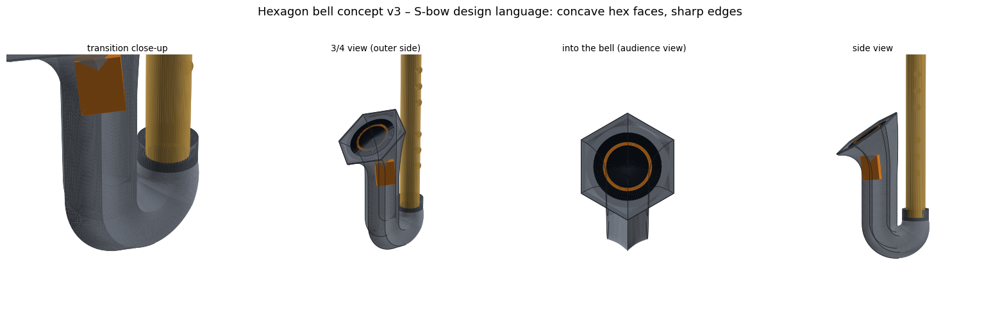

# electric-sax

A 3D-printed hexagonal bell for the **EMEO MK1** digital saxophone that turns it into a self-contained stage instrument:

- **Concert mode:** EMEO → CME H2MIDI Pro → MIDI panel socket → midiBeam wireless → stage PC. Logo ring lit. No computer in the bell needs to run.
- **Practice mode:** a Raspberry Pi 5 with Zynthian and a DAC Pro plays the EMEO into headphones.
- One 2S2P 18650 pack, one USB-C charge port, three switched rails (MIDI / Pi / LED).
- V2: a 5" round display in the bell mouth (the pocket is already in the V1 print).



## Repository

```
cad/                 parametric CAD (Python: trimesh + manifold3d)
  build.py           builds every printable part -> cad/build/
  esax/              geometry: geom.py (sweep + hex profile), bell.py (all parts), components.py (fit check), viewer.py
  components/        catalog.yaml (dimensions of every bought part + confidence), layout.yaml (where they sit)
  vendor/            third-party / pre-existing meshes (Nerd-Sniped clamp, own S-bow)
  viewer/            three.js preview template
firmware/led-ring/   XIAO RP2040 CircuitPython code for the logo LED ring
pi/                  Zynthian setup, EEPROM/config snippets, INA219 battery monitor
docs/                architecture & wiring, BOM, decisions, measurements guide, print guide, test log, research notes
```

## Build the CAD

```bash
cd cad
python -m venv .venv && . .venv/bin/activate
pip install -r requirements.txt
python build.py --fit --viewer
```

Outputs (`cad/build/`, not committed): STL + 3MF per part, `report.json`, `fit_report.txt`, `proxies.stl`, `viewer.html` (open in a browser). A full build takes a few seconds.

## Status (Nov 2026)

- V1 shell designed (parts A–H). Not printed yet: print the hole gauge F and the collar fit test H + G first.
- Parts ordered from Conrad, Botland, Amazon – see `docs/bom.md`.
- **Next:** measure every part (`docs/measurements.md`), fill `cad/components/catalog.yaml`, then design the internal electronics sled.

## Credits

The EMEO clamp is remixed from [Nerd-Sniped's EMEO Headless Computer](https://www.printables.com/model/1579980-emeo-headless-computer) (OCL v1). See `LICENSES.md`.
