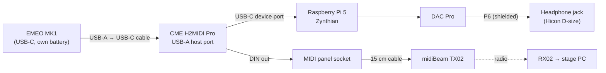
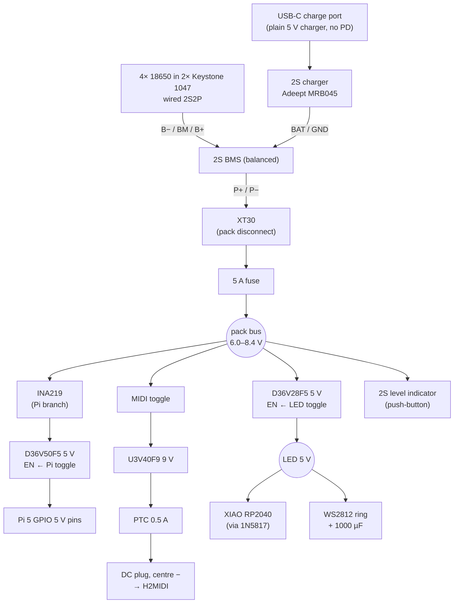

# Architecture and wiring

Status: planned, nothing soldered yet. Values marked **verify** must be checked against the real part or datasheet before wiring.

## Signal path

- Concert mode: Pi **off**. MIDI goes EMEO → H2MIDI → DIN → TX02 and never touches the Pi, so a Pi crash can't kill the gig.
- Practice mode: Pi on, Zynthian plays to headphones.
- H2MIDI routing (USB-A → DIN **and** USB-A → USB-C) is set once in HxMIDI Tools and stored in the device.
- The EMEO charges from the H2MIDI host port (≤500 mA). Fine: the pack has plenty of margin in concert mode.

## Power

One 2S2P Li-ion pack (4× Samsung 35E, ~7.4 V nominal, 6.9 Ah, ~50 Wh), one charge port, three independently switched rails.

### Rules behind this layout

| Rule | Why |
|---|---|
| MIDI toggle **before** the U3V40F9 | Its EN pin doesn't fully disconnect: battery voltage leaks through the inductor and diode. The toggle carries ≤0.3 A, fine for the MTS-102. |
| Pi and LED toggles switch the Pololu **EN** pins (EN → GND = off) | Tiny signal current; the switches never carry the load. |
| Pi: press the button, wait for shutdown, **then** flip the Pi toggle | The toggle is a hard power cut. With `POWER_OFF_ON_HALT=1` the Pi draws ~0.01 W when halted anyway. |
| Undervoltage cutoff ~6.4 V (3.2 V/cell) on both D36V regulators | The BMS only cuts at ~2.3–2.6 V/cell. Set with a divider on EN – **verify** the EN threshold in the Pololu datasheet before choosing resistors. |
| INA219 only in the Pi branch | Measures pack voltage + Pi current; the 0.1 Ω shunt never sees the other rails. |
| Pi powered via GPIO 5 V | Bypasses the Pi's USB-C input path. Never plug a USB-C supply into the Pi at the same time (back-feed). |
| Charger on the BMS P side | Charging goes through the BMS protection. Balancing happens only while charging. |
| 1N5817 into the XIAO 5 V pin | Plugging the XIAO into USB for programming must not back-feed the LED rail. |

### Wire gauges

| Run | Wire |
|---|---|
| Cells → BMS → XT30 → fuse → regulators, Pi 5 V | 20 AWG / 0.5 mm² silicone, red/black |
| 9 V MIDI rail | 20 AWG yellow |
| Balance lead (BM), EN lines, button, I²C, LED data | 24 AWG / 0.25 mm² |
| Headphone signal | Shielded cable, DAC Pro P6 → jack |

## Pin and connector assignments

| Device | Pin / pad | Goes to |
|---|---|---|
| Pi 5 | GPIO header pins 2 + 4 (5 V), 6 (GND) | D36V50F5 VOUT / GND |
| Pi 5 | J2 power-button pads | GQ16F button NO contact |
| Pi 5 | GPIO 2 / 3 (I²C SDA/SCL) | INA219 (0x40). DAC Pro codec also on I²C at 0x4c |
| GQ16F button | LED + / − | Pi 5 V via **150 Ω** (≈15 mA; LED Vf 2.8 V, no internal resistor) |
| DAC Pro | P6: 1 L, 2 GND, 3 R, 4 GND, 5 detect | Headphone jack (shielded) |
| DAC Pro | P1 | Line out – not used in V1 |
| XIAO RP2040 | D10 (GPIO3) | 74AHCT125 input A1; Y1 → 330 Ω → ring DIN |
| 74AHCT125 | VCC 5 V (LED rail), 1OE → GND, unused inputs → GND | |
| WS2812 ring | 5V / GND / DIN | LED rail, 1000 µF/10 V across 5V–GND at the ring |
| H2MIDI | USB-A | EMEO (USB-A → USB-C cable; MK1 does not accept C-to-C) |
| H2MIDI | USB-C | Pi 5 USB port |
| H2MIDI | DIN out | MIDI panel socket (pins 4/5 + shield 2) |
| H2MIDI | DC in | 9 V rail, 5.5/2.1 mm, centre **negative** |
